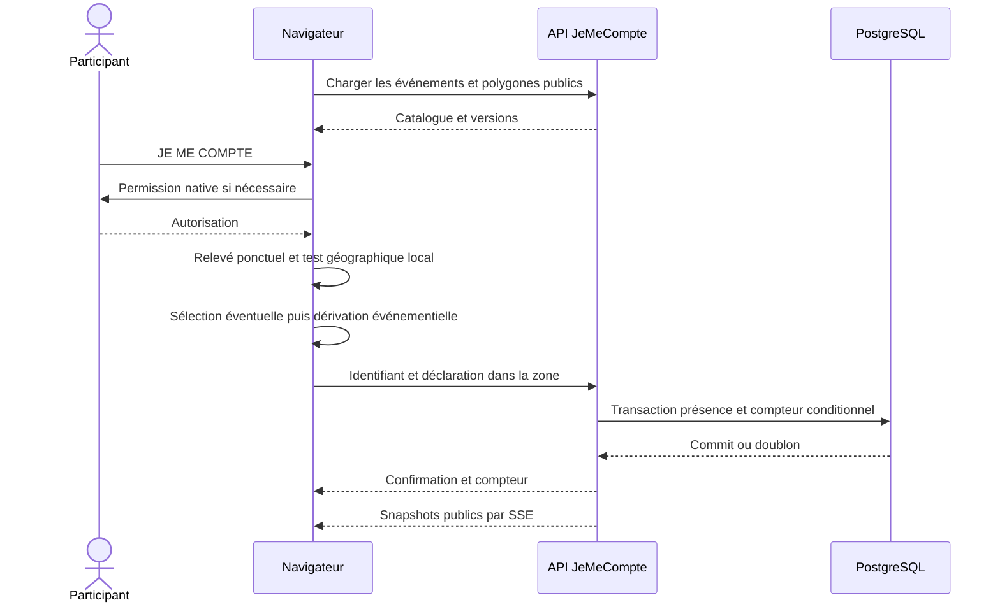

# JeMeCompte.fr — plan du MVP

Document de décision et d’implémentation, rédigé le 16 octobre 2026. Le répertoire a été inspecté : il est vide, sans application, dépendance ni configuration existante. Ce document est le seul livrable de cette phase. Les chemins mentionnés ci-dessous désignent des fichiers futurs.

**Proposition : un monolithe SvelteKit, PostgreSQL, une clé aléatoire locale, une géofence vérifiée dans le navigateur et des compteurs transactionnels diffusés par SSE.** Pas de fingerprinting, PostGIS, Redis, application native ou comptage crédité hors ligne pour le pilote.

Les paramètres numériques sont des valeurs initiales à tester, pas des garanties de capacité ou des durées imposées par la loi. Les décisions juridiques conditionnant une collecte réelle sont signalées explicitement.

## 1. Résumé du produit

JeMeCompte.fr recueille des participations volontaires à un rassemblement public. Il ne mesure ni l’ensemble de la foule, ni un nombre certifié d’humains distincts, ni l’effectif maximal présent simultanément.

Le parcours nominal sur la page d’un événement est : ouvrir, appuyer sur **JE ME COMPTE**, autoriser un relevé de position si le navigateur le demande, recevoir la confirmation du serveur et voir le compteur. Aucun compte participant, nom, email, téléphone, passkey, QR code ou installation obligatoire.

Le chiffre techniquement mesurable est : **nombre de participations acceptées avec des identifiants événementiels distincts, selon les règles publiées**. La formule produit « X personnes se sont comptées ici » doit être accompagnée d’une explication visible : comptage volontaire, contrôle de localisation local et contournable, absence d’estimation exhaustive. Éviter « X présences vérifiées », « X humains uniques » et toute certification implicite.

Une même personne à deux manifestations peut contribuer deux fois au national. Une personne passant à deux endroits de la même manifestation ne doit contribuer qu’une fois avec la même identité locale. Le total est cumulatif sur l’événement ; ce n’est pas un compteur de personnes encore présentes.

Le premier test terrain doit porter sur un événement public préparé par l’équipe, avec un périmètre et des horaires connus, et un opérateur disponible.

## 2. Hypothèses et décisions structurantes

| Sujet | Décision proposée | Conséquence ou limite |
|---|---|---|
| Présence physique | Déclaration dont le client officiel vérifie localement la géofence | Le serveur ne possède aucune preuve indépendante de présence |
| Identité | Clé locale aléatoire ; identifiant différent par événement | Effacement, autre navigateur ou appareil permettent une nouvelle identité |
| Confidentialité | Pas de coordonnées envoyées au service ; pas d’identité globale serveur | Les connexions réseau et les données événementielles restent sensibles |
| Accueil sans position | Gros bouton générique et catalogue public préchargé | Impossible de connaître automatiquement l’événement local avant autorisation sans autre indice |
| Événements proches | Choix explicite si plusieurs polygones correspondent | Un clic supplémentaire est parfois indispensable |
| Ouverture | Statut administratif autorisant les inscriptions et fenêtre serveur `[startsAt, endsAt[` | L’horloge du téléphone ne décide jamais d’une admission |
| Fraude | Réduire les abus simples et signaler les anomalies | Aucune défense forte contre une campagne distribuée créant de nouvelles identités |
| Nombre national | Somme des participations acceptées pendant le jour civil `Europe/Paris` | Ce n’est pas un total de personnes uniques en France |
| Administration | CLI sur accès SSH à clés, séparée de l’API publique | Pas de backoffice ni d’inscription d’organisateurs au pilote |
| Déploiement | Une instance Node et PostgreSQL dans une région européenne | Point de panne applicatif accepté au pilote ; restauration indispensable |
| PWA | Application web utilisable sans installation, cache limité | Aucune promesse de comptage sans serveur joignable |
| Juridique | Qualification et bases légales à valider avant le terrain | Le parcours « un clic » ne doit pas dicter une interprétation juridique |

**Anonymat d’usage et anonymisation juridique sont différents.** Les participants n’ont pas à s’identifier, mais une présence pseudonyme liée à une manifestation peut rester une donnée personnelle, voire sensible. La promesse doit décrire les traitements réels.

Hors périmètre : création publique d’événements, paiements, notifications push, carte des participants, suivi de trajet, recherche de personnes, classement politique, estimation corrigée de la foule et export de présences individuelles.

## 3. Architecture proposée

### Composants

- **Navigateur** : interface Svelte, géolocalisation ponctuelle, test géographique, Web Crypto, IndexedDB, état de tentative et connexion SSE.
- **SvelteKit/Node** : pages publiques, catalogue, API de participation, validation, protections réseau temporaires et snapshots de compteurs.
- **PostgreSQL** : événements, présences pseudonymes temporaires, compteurs durables et journal administratif séparé.
- **Reverse proxy HTTPS** : TLS, limites de taille et de connexions, diffusion des ressources statiques, transport SSE sans buffering.
- **CLI opérateur** : importer, vérifier, publier, suspendre et clôturer un événement ; réconcilier et purger les données.

Une seule origine canonique, `https://jemecompte.fr`. Rediriger `www` avant utilisation : les clés IndexedDB sont liées à l’origine. Aucun Express, backend séparé, broker ou microservice.

### Challenge des choix techniques

| Choix envisagé | Arbitrage |
|---|---|
| SvelteKit récent | Retenir une version stable et supportée au démarrage, avec l’adaptateur Node officiel. SSR pour une première page légère ; interactivité limitée au besoin. Pas de fonctionnalités expérimentales nécessaires. |
| TypeScript strict | Retenir. Les types ne valident pas les entrées HTTP : ajouter des schémas d’exécution stricts. |
| Tailwind récent | Facultatif. Pour quelques écrans, CSS Svelte et variables CSS suffisent. Recommandation minimale : CSS natif ; conserver Tailwind si l’équipe y gagne réellement. Sa branche v4 cible notamment Safari 16.4+, Chrome 111+ et Firefox 128+, à comparer aux téléphones visés. |
| PostgreSQL | Retenir : contraintes, transactions, concurrence et sauvegardes connues. SQLite n’apporte pas d’avantage décisif au déploiement envisagé. |
| PostGIS | Écarter : pas de requêtes sur des positions participantes ; quelques polygones publics en JSONB suffisent. Réexaminer seulement si le catalogue ou les opérations spatiales serveur changent d’échelle. |
| Drizzle | Retenir pour schéma et migrations SQL relues, avec un seul driver PostgreSQL. Garder l’opération critique lisible et paramétrée ; l’ORM n’apporte pas l’atomicité à lui seul. |
| API SvelteKit | Retenir des routes HTTP ordinaires ; pas de GraphQL, tRPC ou service d’authentification participant. |
| SSE | Retenir pour les compteurs en diffusion unidirectionnelle, avec polling de secours. Le résultat du clic passe toujours par une réponse POST. |
| PWA | Retenir manifeste et service worker minimal ; pas de plugin lourd ni de promesse de synchronisation garantie en arrière-plan. |

Sources techniques : [adaptateur Node SvelteKit](https://svelte.dev/docs/kit/adapter-node), [service workers SvelteKit](https://svelte.dev/docs/kit/service-workers), [compatibilité Tailwind](https://tailwindcss.com/docs/compatibility), [Drizzle et PostgreSQL](https://orm.drizzle.team/docs/get-started-postgresql). Les documentations évoluent : choisir des versions stables puis les verrouiller, sans copier automatiquement une commande utilisant une préversion.

### Contrats HTTP prévus

| Route future | Rôle | Cache et données |
|---|---|---|
| `GET /` | Accueil, bouton et catalogue initial borné | Contenu public, sans identifiant participant |
| `GET /evenements/[slug]` | Contexte explicite d’un événement | Métadonnées publiques ; compteur éventuellement âgé de quelques secondes |
| `GET /api/events` | Catalogue publié, périodes, polygones, versions | Cache public court, ETag ; jamais une recherche à partir de coordonnées |
| `GET /api/events/[id]/counters` | Snapshot événement et national du jour | Cache public de quelques secondes |
| `POST /api/events/[id]/presences` | Acceptation ou reconnaissance d’un doublon | Corps JSON strict ; réponse `no-store` |
| `POST /api/events/[id]/presence-status` | Retrouver une confirmation sans créer de présence | Corps contenant l’identifiant événementiel ; réponse `no-store` |
| `GET /api/events/[id]/stream` | Snapshots SSE publics | Aucun identifiant dans URL, cookie ou message |
| `GET /comment-ca-marche` | Méthode, limites et protocole | Page publique statique |
| `GET /confidentialite` | Information et exercice des droits | Page publique statique |

Le POST contient seulement l’identifiant événementiel, la version de géofence, la version du protocole et l’assertion `insideZone: true`. Il ne contient ni position, précision GPS, heure du relevé, IP, user-agent collecté en JavaScript ou identifiant global. Des champs nécessaires au consentement/retrait pourront être ajoutés après la décision juridique de l’étape E0, pas par anticipation silencieuse.

Réponses métier stables : `counted`, `already_counted`, `not_open`, `ended`, `paused`, `event_updated`, `invalid_request`, `rate_limited`, `temporarily_unavailable`. Un doublon valide retourne un succès idempotent, pas une erreur anxiogène. `429` et `503` portent un `Retry-After`. Aucune nouvelle présence ne reçoit une confirmation avant commit.

## 4. Flux d’une participation



Les coordonnées n’apparaissent pas dans les échanges avec JeMeCompte. La déclaration transmise n’est pas une preuve cryptographique de sa sincérité. En cas de refus, hors zone ou précision insuffisante, le client officiel n’envoie aucune nouvelle participation.

## 5. Modèle de données et règles métier

### `events`

| Champ | Type proposé | Règle |
|---|---|---|
| `id` | UUID | Identité immuable, distincte du slug |
| `slug` | Texte unique | URL lisible ; une modification ne crée pas une nouvelle identité |
| `name` | Texte borné | Texte échappé, pas de HTML libre |
| `city_code`, `city_name` | Textes bornés | Code de ville stable pour les regroupements ; pas de géocodage participant |
| `description` | Texte nullable | Texte brut uniquement au MVP |
| `geofence` | JSONB GeoJSON Polygon | Géométrie publique validée avant publication |
| `geofence_version` | Entier positif | Change lors d’une correction du périmètre |
| `metadata_version` | Entier positif | Incrément à chaque changement administratif ; indépendant des révisions de compteur |
| `starts_at`, `ends_at` | `timestamptz` | `starts_at < ends_at` ; stockées en UTC, affichées en heure française |
| `status` | Enum ou texte contraint | `draft`, `published`, `paused`, `closed`, `cancelled` |
| `integrity_status` | Texte contraint | `normal`, `anomaly`, `suspended` ; qualification opérationnelle, pas score scientifique |
| `protocol_version` | Entier | Version de dérivation et contrat figée pour l’événement |
| `created_at`, `updated_at` | `timestamptz` | Métadonnées administratives |
| `finalized_at`, `presences_purged_at` | Dates nullables | Clôture de la réconciliation puis preuve de purge opérationnelle |

L’ouverture effective exige `status = published` et l’heure serveur dans la fenêtre. « À venir » et « terminé » sont des états calculés : un cron raté ne doit pas maintenir un événement ouvert. Une suspension bloque les nouvelles inscriptions ; elle ne retire pas les confirmations passées.

Identité, ville et version cryptographique sont gelées après publication. Horaires et périmètre se corrigent par une opération explicitement journalisée ; pour un périmètre ouvert, suspendre, versionner, puis republier. Les clients obsolètes doivent refaire le test local. Ne jamais attribuer un nouvel UUID pour contourner une erreur : cela autoriserait un second comptage.

### `presences`

| Champ | Type proposé | Règle |
|---|---|---|
| `event_id` | UUID, clé étrangère | Pas de suppression accidentelle en cascade d’un événement compté |
| `anonymous_event_id` | `bytea`, exactement 32 octets | Identifiant pseudonyme opaque |
| `counting_day` | `date` | Jour d’acceptation côté serveur, fuseau `Europe/Paris` |

Clé primaire composite **`(event_id, anonymous_event_id)`** : elle réalise le `UNIQUE` demandé. Aucun `id` supplémentaire nécessaire. Index additionnels uniquement après examen des requêtes et volumes.

**Supprimer `createdAt` individuel du modèle initial** tant qu’aucun besoin démontré ne l’exige : le jour suffit aux agrégations et la purge dépend de la fin de l’événement. L’heure précise sert transitoirement à l’admission, sans être conservée par personne. Aucun IP, fingerprint, score individuel, coordonnées, précision ou identifiant d’un autre événement.

Si la base légale retenue exige une preuve de consentement individualisée ou un mécanisme de retrait, E0 doit préciser les champs strictement nécessaires avant la migration initiale. Une version de notice n’autorise pas à affirmer, à elle seule, qu’un consentement valide a été obtenu.

### `event_counters`

| Champ | Type proposé | Règle |
|---|---|---|
| `event_id` | UUID | Référence à l’événement |
| `counting_day` | `date` | Jour civil français d’acceptation |
| `count` | `bigint`, défaut zéro | Contrainte `count >= 0` |
| `revision` | `bigint`, défaut zéro | Incrément à chaque modification ; ordre des snapshots, y compris lors d’une correction justifiée |

Clé primaire **`(event_id, counting_day)`**. La ligne compteur est séparée de la ligne événement pour éviter les conversions de verrous décrites en section 11. Représenter les grands entiers sans perte dans le contrat JSON, par exemple par une chaîne décimale.

- Événement : somme de ses compteurs journaliers.
- National du jour : somme des compteurs de la date française courante.
- Ville du jour : même somme, filtrée par le code de ville de l’événement.
- Événement traversant minuit : unicité sur tout l’événement ; une présence n’appartient qu’au jour de sa première acceptation. Elle n’est pas recomptée le lendemain.
- Une personne participant à deux événements apporte deux participations au national. Aucune déduplication interévénements.

### Administration

Un journal `admin_audit` conserve opérateur, action, événement, date, raison et version de configuration, sans présence participante. Pas de table `User` pour les participants. Les identités des opérateurs relèvent de l’accès SSH et des comptes d’exploitation.

Pas de table de corrections individuelles ni de suppression statistique automatique des « fraudeurs ». Une anomalie peut changer l’avertissement public et suspendre l’admission. Toute correction effective de données doit être justifiée, publiée et cohérente avec les compteurs ; elle ne peut être un changement arbitraire du chiffre affiché.

## 6. Identité locale anonyme : proposition précise

### Construction retenue

À la première action de participation, générer avec Web Crypto une **clé HMAC SHA-256 de 256 bits**, non exportable, autorisée pour `sign`. Conserver le `CryptoKey` directement dans IndexedDB, sous une clé singleton. Le secret brut n’est ni exporté, ni envoyé, ni stocké en JSON ou dans un cookie.

Définition du protocole, sans code applicatif :

```text
message = UTF8("jemecompte.fr\0presence:v1\0" + eventUuidCanonique)
anonymousEventId = base64url_sans_padding(HMAC-SHA-256(cleLocale, message))
```

L’UUID est au format canonique minuscule, validé des deux côtés. Conserver les 256 bits : 43 caractères base64url sans padding, décodés en 32 octets côté serveur. Rejeter les encodages non canoniques. Utiliser l’UUID, jamais le slug, le polygone, la date ou une concaténation ambiguë de champs.

**Pourquoi HMAC plutôt que SHA-256 d’une concaténation, PBKDF2 ou une paire de clés ?** HMAC fournit directement une dérivation pseudorandom avec séparation de domaine. Il n’y a pas de mot de passe à ralentir, de signature publique à vérifier ou de secret à échanger. Une bibliothèque cryptographique supplémentaire serait inutile. Voir les primitives et limites de [Web Crypto](https://www.w3.org/TR/WebCryptoAPI/).

Le backend ne connaît pas la clé et **ne peut pas vérifier que cet identifiant a été dérivé honnêtement**. Pour lui, il s’agit de 32 octets opaques. HMAC ne transforme ni l’identité locale ni le résultat GPS en preuve vérifiable.

### Première utilisation dans plusieurs onglets

1. Préparer une clé candidate avant la transaction IndexedDB.
2. Ouvrir une transaction `readwrite` sur le magasin d’identité.
3. Lire le singleton ; réutiliser l’existant, ou enregistrer la candidate si absent.
4. Attendre la fin effective de la transaction avant de dériver ou d’envoyer.

Les transactions d’écriture sur le même magasin ordonnent cette initialisation. Ne pas attendre une génération Web Crypto au milieu de la transaction, au risque de la rendre inactive. Aucun verrou distribué, BroadcastChannel ou bibliothèque de concurrence nécessaire à cette opération. Référence : [transactions IndexedDB](https://www.w3.org/TR/IndexedDB-3/).

### Stockage, migration et limites

- Tester réellement persistance et relecture de `CryptoKey` sur Safari/iOS, Firefox, Brave et Chrome/Android. L’émulation WebKit ne suffit pas pour qualifier iOS.
- Si IndexedDB est indisponible ou l’écriture échoue : **ne pas compter automatiquement avec une nouvelle clé volatile à chaque essai**. Afficher une erreur de stockage et les moyens de réessayer. Un mode mémoire affaiblirait encore l’unicité et n’est pas retenu au pilote.
- La navigation privée peut autoriser un stockage éphémère sans qu’on puisse ou doive la détecter. L’effacement utilisateur et l’éviction navigateur restent possibles ; aucun mécanisme de « résurrection » du secret.
- `extractable: false` empêche l’export normal par l’API, pas l’utilisation de la clé par un XSS exécuté sur la même origine. Pas de promesse de coffre matériel ou d’inviolabilité.
- Ne pas changer de domaine, d’origine ou de version de dérivation pendant un événement ouvert. Garder la dérivation `v1` pour les événements qui l’utilisent, même après une mise à jour du site.
- Proposition à valider en E0 : durée cible de 12 mois pour la clé, avec politique exacte d’expiration décidée avant mise en œuvre. **Pas de rotation automatique pendant le pilote.** Ne pas annoncer un maximum ferme incompatible avec la conservation d’une identité d’événement actif, suspendu mais réouvrable, ou encore dans sa fenêtre de récupération/droits. Une rotation future doit traiter ces cas sans créer un second identifiant ; ne pas ajouter un historique durable de manifestations pour ce seul besoin. Chaque action relit le singleton plutôt qu’une ancienne clé gardée indéfiniment dans un onglet.
- Bouton d’effacement local dans les paramètres de confidentialité, expliquant qu’il retire le moyen de reconnaître les participations précédentes et éventuellement d’exercer un droit avec ce terminal. Impossible de garantir une suppression à distance sur un navigateur qui ne revient jamais.

Sans la clé, les seuls identifiants événementiels ne permettent pas de retrouver trivialement lesquels appartiennent au même secret, sous les hypothèses usuelles de HMAC. Cela ne couvre pas IP, horaires d’accès, XSS, terminal compromis, sauvegarde du navigateur ou serveur distribuant un JavaScript malveillant. Les politiques de stockage, notamment celles de Safari, interdisent de promettre une persistance éternelle : [WebKit, prévention du tracking](https://webkit.org/tracking-prevention/).

## 7. Analyse de `device-uuid` et du fingerprinting

**Recommandation ferme : ne pas intégrer de fingerprint au MVP, y compris une version maison « légère ».**

Le [dépôt officiel `device-uuid`](https://github.com/biggora/device-uuid/) présente actuellement une API TypeScript, des signaux navigateur/écran et des collecteurs avancés optionnels. Des évolutions figurent en 2026 : il serait inexact de l’écarter comme simplement abandonné. Son activité ne démontre cependant aucune propriété d’unicité humaine.

Dans le [code de `DeviceUUID`](https://raw.githubusercontent.com/biggora/device-uuid/master/src/core/DeviceUUID.ts), le résultat synchrone vient de caractéristiques hachées avec MD5 puis formatées comme un UUID : il ne s’agit pas d’un identifiant aléatoire cryptographique d’appareil. Les collecteurs avancés peuvent exploiter canvas, WebGL, audio et polices. Le champ nommé `confidence` ne constitue pas une probabilité de reconnaître un humain distinct.

| Approche | Valeur éventuelle | Problèmes pour JeMeCompte | Décision |
|---|---|---|---|
| `device-uuid` basique | Configuration grossière, diagnostic secondaire | Collisions entre téléphones semblables ; changement d’UA, d’écran ou de version ; facilement falsifiable | Exclure |
| `device-uuid` avancé | Davantage de caractéristiques | Collecte intrusive, bruit ou blocages, travail supplémentaire sur mobile | Exclure |
| Empreinte maison | Peu de code initial | Même absence de fiabilité ; dette de maintenance et tentation d’élargir la collecte | Exclure |
| FingerprintJS côté navigateur | Collecteurs et intégration plus aboutis | Son propre dépôt reconnaît spoofing et reverse engineering ; aucun lien fiable avec une personne ou une position | Exclure |
| Identification commerciale avec traitement serveur | Signaux réseau et service opéré | Fournisseur supplémentaire, corrélation potentielle, transferts et finalités à examiner, coût | Exclure |
| Clé aléatoire locale | Dédoublonnage simple du client coopératif | Réinitialisable, multipliable | Retenir avec limites explicites |

Comparaison des environnements :

- **Safari/iOS** : protections, restrictions et bruit selon version et contexte ; de nombreux appareils peuvent se ressembler. Ne pas contourner ces protections. [WebKit, Safari 26](https://webkit.org/blog/17333/webkit-features-in-safari-26-0/).
- **Firefox** : blocage de scripts identifiés et réduction de certaines surfaces selon la protection choisie. [Mozilla, protection contre le fingerprinting](https://support.mozilla.org/en-US/kb/firefox-protection-against-fingerprinting).
- **Brave** : randomisation de surfaces et protections renforcées notamment GPU ; une empreinte n’est pas une constante. [Brave, protections WebGL/WebGPU](https://brave.com/privacy-updates/38-webgl-webgpu-fingerprinting-protections/).
- **Chrome/Android** : réduction de l’UA ; les Client Hints ne doivent pas servir à reconstruire une empreinte à haute entropie. [Documentation Chrome](https://developer.chrome.com/docs/privacy-security/user-agent-client-hints).

Un taux de collision ou de stabilité devrait se mesurer sur une population réelle ; aucune valeur crédible n’est disponible pour ce projet. Hacher les caractéristiques ne supprime ni les collisions ni la possibilité de reconnaissance. Un hash simple de caractéristiques et d’`eventId` reste souvent énumérable. Source comparative : [FingerprintJS officiel](https://github.com/fingerprintjs/fingerprintjs).

Le gain anti-abus serait faible contre un script qui choisit lui-même ses valeurs, alors que le coût de confiance et l’analyse ePrivacy augmenteraient. N’utiliser aucun identifiant matériel ni détection de navigation privée.

## 8. Stratégie de géolocalisation

### Sélection de l’événement

Sur `/`, aucune géolocalisation IP et aucune demande à l’arrivée. Précharger un petit catalogue public des événements publiés pertinents dans le temps. Au clic, chercher les correspondances **dans le navigateur**. Une seule : poursuivre ; plusieurs : demander le choix ; aucune : afficher hors zone et permettre de consulter le catalogue sans se compter.

Un lien direct vers un événement affiche son nom et ses horaires avant le clic. Le pilote à un seul événement simplifie aussi l’information préalable. Si le catalogue grossit, proposer une sélection de ville explicite plutôt qu’envoyer une position au serveur. Ne pas charger tous les polygones de France sans borne de taille.

### Acquisition et contrôle local

- HTTPS obligatoire ; appel ponctuel `getCurrentPosition`, jamais `watchPosition`.
- Au clic : demande de haute précision, `maximumAge: 0`, délai indicatif de 15 secondes. La haute précision n’est qu’une préférence donnée au navigateur.
- Seuil initial de précision annoncée : 100 mètres maximum, ajustable après essai terrain. Au-delà : « Position insuffisamment précise », avec nouvelle tentative volontaire.
- Test point-dans-polygone, frontière incluse et comportement testé. Le point GeoJSON est ordonné **longitude, latitude**.
- Ne pas agrandir automatiquement la zone avec le rayon d’incertitude ; une localisation très imprécise ne doit pas rendre la ville éligible.
- Un point annoncé à l’intérieur peut correspondre à une personne physiquement à l’extérieur. Un seuil de précision ne supprime pas cette incertitude. Aucun cercle d’exactitude garanti.
- Ne garder le résultat de position en mémoire que le temps du calcul et de la sélection. Ne pas le sérialiser, le mettre en file d’attente ou le passer à un outil de télémétrie. La libération mémoire JavaScript n’est pas un effacement matériel instantané garanti.
- Si l’envoi n’a pas commencé dans les 60 secondes suivant le relevé, demander un nouveau relevé avant une nouvelle admission. Ce contrôle client améliore le parcours honnête ; le serveur ne peut en prouver le respect.

L’application choisit un usage ponctuel, mais ne peut imposer une permission native à usage unique : sa durée dépend du navigateur et de l’utilisateur. Le navigateur ou l’OS peut solliciter son propre fournisseur de localisation. La promesse exacte porte sur les requêtes et stockages **de JeMeCompte**, pas sur toute la chaîne du téléphone. Référence : [spécification Geolocation](https://www.w3.org/TR/geolocation/).

### Création des périmètres

Opérateur identifié, périmètre préparé avec un outil cartographique local, export GeoJSON puis import CLI avec validation et aperçu. Aucun service de carte tiers dans le parcours participant.

Au pilote : un `Polygon` simple, un anneau extérieur fermé, sans trous ni MultiPolygon, au plus 500 sommets et 50 Ko de configuration géographique. Rejeter coordonnées non finies, anneau dégénéré, auto-intersections, dimensions inattendues et géométries non supportées. Limiter le périmètre à une zone locale validée manuellement ; pas de traversée de l’antiméridien ou de traitement mondial au MVP.

Pour un cortège, publier un corridor statique incluant l’itinéraire et les espaces autorisés, pas une zone mouvante suivant les téléphones. Cela autorise un comptage n’importe où dans ce périmètre pendant la fenêtre ; cela ne prouve pas l’appartenance au cortège. Faire un test à pied et vérifier trottoirs, places et rues encaissées avant publication.

Utiliser le module ciblé [Turf `booleanPointInPolygon`](https://turfjs.org/docs/api/booleanPointInPolygon) côté client et [Turf `kinks`](https://turfjs.org/docs/api/kinks) pour compléter la validation administrative des intersections, avec les autres contrôles explicites. Ne pas importer toute la bibliothèque Turf.

### Compromis anti-spoofing

| Alternative | Ce qu’elle ajoute | Ce qu’elle ne résout pas | Arbitrage |
|---|---|---|---|
| Coordonnées envoyées systématiquement | Serveur capable de refaire le calcul | GPS et entrée client toujours falsifiables ; collecte sensible | Refuser au MVP |
| Cellule géographique ou position arrondie | Localisation grossière exploitable au serveur | Même mensonge possible ; divulgation supplémentaire | Écarter |
| HMAC, nonce ou preuve à divulgation nulle sur le calcul | Intégrité d’un protocole ou preuve du calcul sur une entrée | Authenticité de l’entrée GPS | Écarter comme « preuve de présence » |
| Géolocalisation IP | Approximation réseau | NAT, VPN, relais et mauvaise précision ; surveillance supplémentaire | Écarter |
| QR dynamique, infrastructure physique, attestation/native | Autres signaux possibles | Partage, relais, équipement et nouvelles exclusions | Hors périmètre |

Le meilleur compromis compatible avec le produit est donc de **conserver le contrôle local et d’en publier la faiblesse**, au lieu de collecter plus de localisation sans obtenir une preuve fiable.

## 9. Stratégie anti-fraude progressive

### Prévention retenue au pilote

1. Identité locale et contrainte d’unicité événementielle.
2. Fenêtre et statut contrôlés au serveur ; version courante de géofence exigée pour une nouvelle admission.
3. Validation JSON stricte, corps de participation limité à 2 Ko hors éventuelle extension juridique, délais et pool PostgreSQL bornés.
4. Écriture uniquement par POST JSON. Vérifier `Origin` exact et les métadonnées Fetch lorsqu’elles existent ; pas de CORS ouvert. Ces contrôles limitent des abus depuis d’autres sites, **pas les clients HTTP directs**.
5. Rate limiting temporaire sur pseudonyme événementiel et signal réseau, plus limites globales de concurrence et de débit de protection.
6. Sous surcharge, réponse explicite et retry temporisé ; aucune mise en attente serveur illimitée, aucune confirmation spéculative.

Valeurs de départ à éprouver : 10 tentatives/minute pour un même couple événement/identifiant ; seuil réseau d’alerte autour de 100 nouvelles participations/seconde pendant 10 secondes pour un même signal ; seuil de protection très large autour de 300 requêtes/seconde avec burst 1 000 pour ce signal. Ces valeurs ne sont ni universelles ni des règles de validité du comptage. Les ajuster au test NAT et au budget de l’infrastructure ; un seuil réseau ne doit jamais être assimilé à « une personne ».

Un réseau mobile peut concentrer des milliers de personnes derrière quelques IP. La priorité est de supporter cette foule, pas d’imposer un petit quota par IP. IPv4, IPv6, VPN et Private Relay peuvent changer de signal. Aucun rejet définitif de personne sur cette seule base.

Signal proposé : HMAC serveur sur événement, IP normalisée et fenêtre courte, avec clé de fenêtre éphémère ; RAM uniquement, TTL au plus une heure, aucune association à `presences`. Les règles de normalisation IPv6 sont à tester ; ne pas agréger de grands préfixes en interdictions rigides. L’IP brute est nécessaire transitoirement au transport et à ce calcul, pas à un historique. Pas de simple SHA-256 d’IP, énumérable.

La mémoire est bornée : nombre de buckets et de requêtes simultanées plafonné. Après redémarrage, les limites temporaires peuvent repartir à zéro. Pour une unique instance, cette faiblesse est acceptable et documentée. Ne pas ajouter Redis pour la masquer ; réévaluer seulement lors d’un passage multi-instance.

### Replays et challenges

Le rejeu du même couple ne doit jamais augmenter le chiffre : **l’idempotence neutralise son effet**, même si la requête est reçue plusieurs fois. HTTPS protège le transport. Une personne possédant un identifiant valide ne peut pas, avec ce même identifiant, ajouter plusieurs lignes au même événement.

**Pas de challenge serveur au MVP initial.** Un jeton signé court, lié à événement, identifiant et version, imposerait un contexte récent mais ajouterait un aller-retour sur le réseau saturé. Un script pourrait demander ce jeton lui-même. Une table de nonces consommés n’apporte pas d’unicité supplémentaire ici.

Si les observations démontrent un bénéfice, introduire ensuite un jeton de contexte signé de deux minutes, lié à l’identifiant : le modifier invaliderait le jeton, le rejouer garderait la même clé unique. Un éventuel challenge de calcul local serait activé seulement après mesure, avec une solution accessible pour les téléphones faibles. Aucun de ces mécanismes ne certifie un humain ou un GPS.

### Détection

Conserver uniquement des agrégats opérationnels : tentatives, créations, doublons, refus, `429`, latence et débit par minute. Détecter ruptures brutales, renouvellement massif apparent d’identités depuis un signal temporaire, écart entre disponibilité et acquisitions, ou hausse coordonnée inhabituelle.

Une vague légitime de manifestants ressemble à une attaque. Une anomalie statistique déclenche une vérification opérateur, éventuellement une suspension publiée ; elle ne justifie pas de retirer automatiquement un pourcentage des présences. Pas de modèle de comportement individuel, géographie réseau détaillée ou croisement entre manifestations.

### Niveau de confiance

Afficher une qualification compréhensible : « fonctionnement normal », « anomalie en cours d’examen », « comptage suspendu ». Documenter le motif et la période concernés. Ne pas afficher « fiabilité 97 % » sans méthode et validation indépendantes.

Un attaquant motivé peut générer des valeurs aléatoires valides, mentir sur la zone, changer d’IP et utiliser un botnet. Il peut produire des participations acceptées hors site. **Le MVP est un outil de comptage volontaire à limites publiées, pas un scrutin résistant à des adversaires organisés.** Si l’objectif devient une résistance forte, il faudra modifier les contraintes produit.

## 10. Threat model explicite

Actifs : confidentialité des participants, secret local, intégrité des lignes et compteurs, disponibilité, accès administrateur et confiance dans le chiffre. Adversaires : utilisateur répétant son action, script opportuniste, attaquant distribué, tiers observant le réseau ou le terminal, opérateur/hébergeur compromis. Frontières de confiance : navigateur non fiable pour le serveur, infrastructure de transport, application, base et accès d’exploitation.

| Menace | Mesure proposée | Risque résiduel |
|---|---|---|
| Double clic et deux onglets | Singleton IndexedDB, clé composite SQL, transaction | Une nouvelle identité contourne la protection |
| Effacement IndexedDB | Explication publique ; aucun fingerprint de secours | Recomptage possible |
| Navigation privée | Accepter le stockage si disponible, sans chercher à détecter le mode | Identité souvent perdue à la fermeture |
| Autre navigateur ou installation PWA isolée | Information sur le périmètre de l’identité locale | Un autre stockage peut produire une autre identité |
| Plusieurs appareils | Aucune liaison entre appareils | Plusieurs participations possibles |
| GPS falsifié | Test local pour le client coopératif | Aucun contrôle serveur probant de la vérité du GPS |
| JavaScript modifié ou appel API direct | Validation, fenêtre, quotas, détection | Le résultat `insideZone` et l’identifiant peuvent être inventés |
| Replay ou réponse perdue | Même identifiant, insert conditionnel, retry idempotent | Nouvelles identités non empêchées |
| Création automatisée d’identités | Limites temporaires et surveillance agrégée | Coût de génération très faible ; attaque distribuée efficace |
| Botnet | Limites globales, capacité bornée, suspension opérateur | Impossible de distinguer sûrement bots et foule sans nouvelles contraintes |
| DoS | Proxy, timeouts, pool et mémoire bornés, statique cacheable | Saturation volumétrique de l’hébergeur encore possible |
| Scraping des compteurs et événements | Données publiques cacheables, débit de lecture borné | Leur copie est attendue ; le timing de faibles variations peut informer un observateur |
| Incrément arbitraire / injection | Aucun endpoint fixant le nombre ; SQL paramétré, privilèges restreints | Application ou rôle DB compromis peut corrompre les chiffres |
| Pause/fermeture concurrente | Verrou partagé événement ; update admin exclusif | Une admission déjà autorisée peut finir son commit après la fin de fenêtre |
| XSS | Texte échappé, pas de HTML libre ni script distant, CSP stricte | Peut utiliser la clé non exportable comme oracle et corréler des événements |
| Chaîne de dépendances ou déploiement compromis | Peu de dépendances, lockfile, revue, secrets CI limités | L’open source ne prouve pas quel JavaScript a été distribué à un instant donné |
| Fuite complète DB | Pas de GPS/IP/fingerprint ; HMAC par événement ; purge rapide | Événement et pseudonyme peuvent révéler une participation sensible |
| Corrélation entre événements | Identifiants distincts, pas de clé globale serveur | IP, horaires, observation physique et terminal peuvent corréler |
| Logs application et erreurs | Aucun body, identifiant, IP, query string ou UA complet | Mauvaise configuration d’un middleware peut casser la promesse |
| Reverse proxy, CDN, WAF | Pas de CDN/WAF tiers par défaut ; logs minimisés et contrats examinés | Le prestataire traite des IP et peut avoir ses propres traces |
| Analytics, cartes, polices, pixels | Aucun tiers dans le parcours ; ressources auto-hébergées | Les liens externes doivent aussi éviter les référents sensibles |
| Headers et cache | CSP, `Referrer-Policy: no-referrer`, `nosniff`, anti-iframe, réponses privées `no-store` | Les headers ne rendent pas un client fiable |
| IP et réseau mobile | Usage transitoire, HMAC en RAM, pas de base IP-événement | L’hébergeur et le transport voient les connexions ; la géolocalisation peut dépendre de l’OS |
| Backups, WAL, snapshots et replicas | Chiffrement, accès restreint, rétention courte, purge après restauration | Des présences supprimées restent temporairement dans des sauvegardes |
| Admin compromis ou malveillant | SSH nominatif, clés, rôle séparé, journal des changements | Le serveur distribue le client et contrôle la base : aucun anonymat absolu face à son contrôle total |
| Chiffre sorti de son contexte | Libellés, protocole public, méthode associée à tout export | Un tiers peut toujours le présenter comme une estimation exhaustive |
| Téléphone perdu, extension, malware | Aucun historique local explicite ; clé non exportable par l’API | Le navigateur, l’OS et un code même origine compromis peuvent utiliser la clé |

Prévoir une CSP compatible avec SvelteKit à base de nonces/hashes, sans `unsafe-eval`, avec `connect-src 'self'`, `frame-ancestors 'none'` et ressources locales. `Permissions-Policy` limite la géolocalisation à l’origine ; ne pas casser le parcours sur des navigateurs qui la prennent partiellement en charge. Activer HSTS après validation du domaine. Référence : [CSP W3C](https://www.w3.org/TR/CSP3/).

Le reverse proxy doit écraser les headers de transfert et être le seul à atteindre Node. Ne jamais faire confiance à un `X-Forwarded-For` fourni directement par Internet. Désactiver en production les logs PostgreSQL de paramètres ou requêtes complètes susceptibles de contenir les pseudonymes.

## 11. Compteurs, concurrence et temps réel

### Transaction de participation

Une transaction courte en isolation `READ COMMITTED` suffit si toutes les écritures suivent le même protocole :

1. Valider le format, les limites et les protections HTTP avant de prendre une connexion DB.
2. Commencer la transaction et lire l’événement avec un verrou `FOR SHARE`.
3. Si une présence existe déjà pour le couple, préparer `already_counted` sans réexiger la géolocalisation, la version actuelle ou l’ouverture. Cette reconnaissance reste possible après clôture tant que les présences sont conservées.
4. Pour une nouvelle présence : contrôler statut, version et fenêtre avec `clock_timestamp()` de PostgreSQL obtenu après acquisition du verrou. Ne pas employer `now()` ou `CURRENT_TIMESTAMP`, qui reflètent le début de transaction même après attente du verrou. Définir l’acceptation comme cet instant de décision, pas comme l’heure du téléphone ou l’arrivée supposée dans la foule. Le commit peut finir légèrement plus tard.
5. Insérer avec `ON CONFLICT (event_id, anonymous_event_id) DO NOTHING RETURNING`.
6. Seulement si une ligne a effectivement été créée, incrémenter par SQL `count` et `revision` sur le compteur de ce jour, via un upsert atomique. Ne jamais relire un entier en JavaScript pour lui ajouter un.
7. Commit. En cas d’erreur, rollback de la présence et du compteur ensemble.
8. Répondre avec le résultat et un snapshot confirmé. Une lecture séparée après commit peut inclure des participations encore plus récentes, ce qui est acceptable.

Un conflit concurrent sur l’insertion doit devenir `already_counted`. Faire la lecture suivante dans une **nouvelle instruction**, qui voit le commit attendu ; éviter un CTE astucieux dont le snapshot ne verrait pas encore l’insertion concurrente. Aucun envoi SSE ne précède le commit.

Le verrou partagé sur `events` laisse entrer plusieurs participants simultanément, mais fait attendre une modification administrative exclusive jusqu’à la fin de ces admissions. Le compteur doit rester dans une autre table : verrouiller `events` en lecture partagée puis y incrémenter un champ pousserait plusieurs transactions à convertir leurs verrous, avec risque de deadlock.

Le jour français est calculé à partir du même instant serveur que l’acceptation. Tester minuit et changements d’heure ; ne jamais supposer une journée UTC ni une durée fixe de 24 heures pour le reporting.

Les garanties proviennent des [contraintes et `ON CONFLICT` PostgreSQL](https://www.postgresql.org/docs/current/sql-insert.html), du protocole transactionnel et de [l’isolation PostgreSQL](https://www.postgresql.org/docs/current/transaction-iso.html), pas du navigateur. La distinction entre heure réelle et heure de transaction est documentée dans les [fonctions temporelles PostgreSQL](https://www.postgresql.org/docs/current/functions-datetime.html).

### Lecture, réconciliation et limite du compteur simple

Les affichages lisent `event_counters`, pas `COUNT(*)` sur `presences`. Le national est une somme de petites lignes agrégées ; aucune ligne nationale n’est verrouillée à chaque participation. Une requête partagée peut produire événement, national et ville à partir d’un snapshot cohérent.

Avant purge, une commande compare les compteurs aux présences groupées par événement et jour, en maintenance ou avec une stratégie de lecture cohérente. Un écart est un incident à résoudre, jamais une correction automatique opaque. Après purge, les compteurs finalisés deviennent les seuls agrégats conservés ; ne pas les reconstruire à zéro depuis une table volontairement vidée.

Une ligne par événement/jour **sérialise les incréments**. Cette solution reste correcte sous concurrence mais n’a pas une capacité infinie. Prévoir un pool initial d’environ 10 à 20 connexions et des transactions sans appel réseau ou calcul lent, puis mesurer sur l’infrastructure cible.

Si les attentes de verrou font échouer le budget de latence du test terrain, l’optimisation suivante est limitée : **16 buckets par événement/jour**, choisis côté serveur à partir de l’identifiant ; même insertion conditionnelle, un seul incrément, lecture par somme. Aucun Redis, Kafka ou compteur distribué avant d’avoir épuisé cette amélioration. Ne pas l’implémenter sans résultat de charge le justifiant.

### Diffusion SSE

Le résultat de son propre clic revient immédiatement par POST. Pour les autres participants :

- Un snapshot initial puis des totaux absolus toutes les 3 secondes environ, regroupant les changements. Pas un message par insertion.
- Un seul ordonnanceur par processus relit les agrégats des événements suivis et diffuse un snapshot partagé aux abonnés. **Pas une requête PostgreSQL par connexion SSE.**
- Un seul flux par page visible, sans cookie d’identité ou identifiant participant. Au pilote, limiter le nombre d’événements simultanément suivis au catalogue publié.
- Messages limités : événement, date nationale, totaux, révisions et état opérationnel. Aucun journal public des participations.
- Révision d’un total = somme des révisions de ses lignes compteurs, qui ne sont jamais supprimées ou réinitialisées dans une même génération. Comparer seulement dans le même périmètre, à la même date et dans la même génération de données ; ignorer un snapshot plus ancien. Les baisses justifiées restent possibles : ne pas figer l’interface avec un `max` qui empêcherait toute correction.
- Chaque réponse de compteur porte aussi une génération monotone `counterEpoch`, commune au déploiement et conservée hors de la base restaurée. L’augmenter après toute restauration/reconstruction pouvant faire reculer les révisions ; fermer les anciens flux et invalider les caches de compteurs avant remise en ligne. Une génération inférieure est ignorée ; une génération supérieure remet à zéro la comparaison des révisions. Les clients acceptent alors le nouveau snapshot même plus bas et affichent le statut d’incident. Aucun journal de messages supplémentaire nécessaire.
- Ne pas ignorer le message entier lorsque le compteur n’a pas changé : appliquer séparément les changements administratifs selon `metadata_version` et les états temporels calculés selon l’heure serveur du snapshot. Une pause ou une fin d’événement doit apparaître sans nouvelle participation.
- Heartbeat autour de 20 secondes, nettoyage lors d’un abort, buffers bornés ; déconnecter un client trop lent plutôt qu’accumuler ses messages.
- Reconnexion : renvoyer un snapshot courant. Pas de persistance de deltas, outbox, bus ou dépendance à `Last-Event-ID` pour la justesse.
- Reconnexion temporisée avec jitter pour éviter un retour simultané de milliers de clients. Suspendre le flux quand la page est cachée ; reprendre au premier plan.
- En cas d’échecs répétés, polling toutes les 15 secondes avec jitter ; intervalle plus long si réseau dégradé. Une seule requête de polling en vol.

HTTP/2 côté proxy, `Content-Type: text/event-stream`, `Cache-Control: no-store, no-transform`, configuration sans buffering et délais de connexion vérifiés. Une connexion persistante consomme de la mémoire et des ressources même si elle ne transporte presque rien. Ne pas garder une connexion DB par flux. Référence : [standard SSE / EventSource](https://html.spec.whatwg.org/multipage/server-sent-events.html).

Deux instances futures peuvent chacune relire PostgreSQL toutes les quelques secondes. Les données durables ne dépendent pas de la survie du processus de diffusion. Un broker n’est pas requis pour rétablir le dernier état.

## 12. UX, réseau dégradé et PWA

### Interface minimale

Écran événement : nom et horaire lisibles, très gros bouton **JE ME COMPTE**, compteur, phrase de portée, information courte de confidentialité et accès à « Comment ça marche ? ». Pas de jargon cryptographique dans le parcours.

Texte proposé : **« Sans inscription. Vos coordonnées précises ne sont ni envoyées à JeMeCompte ni enregistrées par le service. »** L’expression « Anonyme » ne doit pas masquer l’explication sur les identifiants événementiels et le traitement réseau.

Thème système via `prefers-color-scheme`, contraste WCAG 2.2 AA visé, focus visible, navigation clavier, zoom 200 %, lecteur d’écran et réduction des mouvements. Bouton cible d’au moins 64 px de haut, grande zone tactile, aucun geste précis nécessaire. Prévoir les zones sûres iOS, orientation et soleil extérieur.

Annonce accessible du résultat du clic et des erreurs. Ne pas annoncer vocalement chaque incrément SSE : le compteur est consultable, mais les variations rapides ne doivent pas saturer un lecteur d’écran. Aucun clignotement ni animation obligatoire.

| État | Comportement attendu |
|---|---|
| Initial | Contexte et chiffre éventuellement daté ; aucune permission demandée automatiquement |
| Localisation en cours | « Vérification de votre position… », bouton protégé contre les doubles actions |
| Autorisation refusée | Expliquer comment réautoriser ; pas de nouvelle demande en boucle ni autre moyen caché de localiser |
| Position indisponible / délai dépassé | Action « Réessayer » ; conserver le contexte de l’événement |
| Précision insuffisante | Message distinct de « hors zone » ; nouvelle mesure volontaire |
| Hors zone | Aucun envoi ; montrer l’événement concerné et ses informations sans carte participante |
| Plusieurs correspondances | Liste courte nom, ville et horaire ; aucun choix automatique ambigu |
| Envoi en cours | « Enregistrement… », feedback immédiat ; pas de `+1` présenté comme acquis |
| Succès | « Vous êtes compté » puis compteur confirmé |
| Doublon | « Vous êtes déjà compté pour cet événement », même si celui-ci est maintenant terminé |
| Réponse perdue | « Confirmation en attente », possibilité de vérifier ; aucune nouvelle identité |
| `429` / surcharge | Message temporaire, délai de reprise ; respecter `Retry-After` |
| Événement modifié | Recharger la configuration et refaire le test local avant nouvelle admission |
| Événement terminé, suspendu ou annulé | Lecture du compteur, motif et statut ; aucune nouvelle inscription |
| Hors ligne | « Hors connexion », dernier chiffre et heure de fraîcheur ; ne pas prétendre disposer du direct |
| Stockage bloqué | Explication et reprise ; aucune génération répétée de clés volatiles |

Si le fondement juridique exige une information ou action supplémentaire, l’intégrer clairement avant l’envoi. Pour un événement découvert après le clic, le consentement éventuel doit aussi concerner cet événement effectivement identifié. Le parcours à un clic reste un objectif, pas une raison d’automatiser une acceptation juridiquement invalide.

### Ce que la PWA met en cache

Service worker SvelteKit natif, manifeste, icônes, shell minimal, CSS/JS versionnés et pages d’information. Cache des seules données publiques explicitement autorisées, catalogue borné et dernier snapshot daté. Configurer une limite d’âge et supprimer les vieux caches à l’activation.

Ne jamais cacher un POST, une réponse de statut individuel, un jeton futur ou une page d’administration. Un cache ne contourne jamais la validation serveur de la fenêtre ou de la version. Les polygones publics ne sont pas des coordonnées participantes, mais une page d’événement dans l’historique du navigateur peut déjà être sensible.

Pas de forçage d’installation ou de rechargement pendant une tentative. Le protocole serveur garde la compatibilité nécessaire aux onglets ouverts ; une version devenue incompatible doit donner une consigne explicite de rafraîchissement.

### Décision sur le comptage hors ligne

**Ne pas accepter de nouvelle participation différée après la clôture au MVP.** Un timestamp client, une ancienne géolocalisation ou une preuve de calcul ne démontre pas à quel instant la personne était sur place. Une file hors ligne acceptée après l’événement changerait la règle de comptage et ouvrirait un canal de fraude facile.

Cas retenus :

1. **Réseau absent avant tout POST** : état hors ligne ; aucun crédit local. Au retour, nouvelle vérification ponctuelle puis envoi si l’événement est encore ouvert.
2. **POST envoyé, réponse perdue** : garder en mémoire la tentative et rejouer le même identifiant ; un commit passé retourne `already_counted`, sans incrément. Si la page disparaît, la clé persistée permet de retrouver le même identifiant en rouvrant l’événement.
3. **Retour tardif après un doute** : vérifier d’abord l’existence de la présence par un POST de statut sans création. Si absente et événement ouvert, nouvelle localisation avant admission ; s’il est terminé, aucune admission rétroactive.
4. **Données individuelles déjà purgées** : afficher « Les détails individuels ne sont plus conservés » ; ne pas conclure « vous n’avez jamais été compté ». L’agrégat reste finalisé.

Prévoir à cet effet `POST /api/events/[id]/presence-status`, corps limité à l’identifiant événementiel, réponse `no-store`, aucun effet d’écriture. Il n’expose pas de liste et retourne seulement le statut du couple fourni. Il permet la récupération après clôture sans affirmer mensongèrement une nouvelle géolocalisation. Les identifiants étant secrets et à forte entropie, le statut n’est pas énumérable en pratique ; cela ne protège pas un identifiant déjà divulgué.

Retries dans l’onglet : délais croissants indicatifs 1, 2, 4, 8, puis 15 secondes maximum, avec jitter, respect de `Retry-After`, et arrêt/reprise au premier plan. `navigator.onLine` n’est qu’un indice : seul un échange réussi prouve la connectivité. Au-delà de la fraîcheur locale de 60 secondes, faire une vérification de statut avant de décider d’une nouvelle admission.

**Pas de file persistante de participations ni de Background Sync au pilote.** Cette simplification évite un historique local d’événements en attente et ne promet pas une exécution que Safari/iOS ou l’OS ne garantissent pas. Le service worker ne peut pas refaire le relevé de géolocalisation requis. Voir le contexte Window dans [Geolocation](https://www.w3.org/TR/geolocation/) et les limites de reprise exposées par la [documentation Background Sync de Chrome](https://developer.chrome.com/docs/workbox/modules/workbox-background-sync).

### Réseau mobile saturé

Budget initial : JS/CSS critiques compressés au plus 100 Ko, transfert du parcours initial au plus 150 Ko pour le pilote, sans police distante, image décorative, carte ou SDK tiers. Mesurer le build réel ; ces budgets peuvent imposer de simplifier davantage.

Précharger les données publiques avant le clic quand le réseau le permet. Regrouper la diffusion des compteurs ; ne pas forcer un refresh après chaque message. Prioriser POST et statut sur les lectures SSE en surcharge. Un polling plus lent reste acceptable si le bouton et sa confirmation fonctionnent.

Tester latence de deux secondes, faible débit, coupures, changement Wi-Fi/mobile et retour simultané de clients. L’auto-hébergement ne débloque pas un réseau radio saturé : aucun objectif de rapidité ne peut être garanti dans ces conditions. La PWA déjà chargée conserve une interface utile ; une première visite entièrement hors ligne ne peut pas charger le service.

## 13. Privacy, RGPD/ePrivacy et durées proposées

### Qualification et validation préalable

L’absence de nom n’établit pas une anonymisation. Une présence pseudonyme associée à un événement peut, selon son objet, révéler une opinion politique, une conviction ou une appartenance syndicale. Examiner **l’article 6 et une éventuelle condition de l’article 9** du RGPD ; ne pas supposer que manifester signifie avoir « manifestement rendu publiques » toutes les données du dispositif. Sources : [CNIL, identification et pseudonymisation](https://www.cnil.fr/fr/identifier-les-donnees-personnelles), [CNIL, données sensibles](https://www.cnil.fr/fr/definition/donnee-sensible), [CEPD, licéité des traitements](https://www.edpb.europa.eu/sme/be-compliant/process-personal-data-lawfully_en).

La permission de géolocalisation du navigateur est une autorisation technique ; elle ne vaut pas à elle seule consentement à tous les traitements. L’absence de coordonnées serveur ne dispense pas d’examiner le traitement local organisé par le service. Les recommandations CNIL sur le mobile apportent des repères, à appliquer au contexte web/PWA avec un conseil compétent. [CNIL, géolocalisation](https://www.cnil.fr/fr/geolocalisation-applications-mobiles-quelles-regles), [CNIL, permissions](https://www.cnil.fr/fr/permissions-applications-mobiles-recommandations-de-la-cnil-pour-respecter-la-vie-privee).

IndexedDB relève de l’analyse de l’article 82 de la loi Informatique et Libertés, comme d’autres accès au terminal. Une exemption pour stockage strictement nécessaire au service de comptage expressément demandé est une hypothèse défendable à instruire, **pas une conformité acquise**. « Anti-fraude » n’est pas une exemption générale. Fingerprinting et réutilisation entre finalités aggraveraient le problème. [CNIL, cookies et autres traceurs](https://www.cnil.fr/fr/cookies-et-autres-traceurs/que-dit-la-loi).

Avant le pilote réel : identifier le responsable de traitement et les éventuels rôles des organisateurs ; documenter finalités, bases légales, destinataires, droits, article 9, article 82, registre, sous-traitants et accès hors EEE. Réaliser au minimum l’examen documenté de nécessité d’une AIPD ; recommandation de mener une AIPD avant le terrain compte tenu du contexte politique et des volumes envisagés. Son caractère juridiquement obligatoire dépendra du traitement final. [CNIL, AIPD](https://www.cnil.fr/fr/ce-quil-faut-savoir-sur-lanalyse-dimpact-relative-la-protection-des-donnees-aipd).

### Inventaire et proposition de rétention

| Données / lieu | Utilité | Durée proposée et contrôle |
|---|---|---|
| Coordonnées et précision, mémoire navigateur | Test local ponctuel | Références abandonnées dès le calcul terminé ; zéro persistance ou télémétrie JeMeCompte |
| Clé HMAC, IndexedDB | Dédoublonnage événementiel | Cible de 12 mois et politique d’expiration à valider en E0 ; pas de rotation automatique pendant le pilote ; effacement local possible |
| Identifiant, événement, jour, PostgreSQL | Unicité et réconciliation | Échéance `endsAt + 48 h`, purge toutes les 15 minutes : tolérance opérationnelle maximale proposée de 15 minutes en service normal ; aucune réouverture après purge |
| Champs de consentement/retrait éventuels | À définir juridiquement | Minimum et purge spécifique fixés en E0 ; pas de champ ajouté « au cas où » |
| IP brute et headers réseau | Acheminement et limitation transitoire | Pas de conservation applicative ; access logs désactivés sur les endpoints participants à toutes les couches contrôlées ; traces prestataire vérifiées séparément |
| Buckets anti-abus HMAC en RAM | Freiner la saturation | TTL maximal 1 h ; clés éphémères détruites ; pas de sauvegarde ni de lien vers Presence |
| Tentative en cours, mémoire de la page | Reprise après réponse perdue | Jusqu’à résolution ou fermeture de la page ; aucune coordonnée |
| Cache public local | Continuité de lecture | Catalogue et snapshots expirés en 24 h au plus ; vieux bundles supprimés lors des mises à jour |
| Erreurs techniques expurgées | Exploitation | 7 jours ; pas de payload, pseudonyme, IP, URL complète ou stack contenant ces données |
| Agrégats techniques par minute | Incidents et capacité | 7 jours, puis suppression ; pas d’historique détaillé public |
| Journal d’administration | Traçabilité des actions habilitées | 6 mois proposés, accès restreint, aucun participant |
| Compteurs finalisés et méthode | Résultat public | Conservation durable envisagée, à examiner notamment pour les très petits effectifs |
| Backups/PITR/WAL/snapshots | Restauration | 7 jours glissants maximum proposés sur toute la chaîne ; chiffrement et accès limité |

Les durées sont des choix proposés à justifier et à vérifier chez le prestataire, pas des obligations inventées. Une présence supprimée en production au plus tard 48 h et 15 minutes après clôture en service normal peut encore exister dans une sauvegarde pendant sept jours supplémentaires : résidu pouvant atteindre environ **neuf jours et 15 minutes après clôture**, selon le calendrier réel. Une panne de purge est un incident à détecter et traiter. Pas de promesse « supprimé partout en 48 h ».

Purge des présences expirées toutes les 15 minutes et vérification après restauration avant remise en ligne. Pour chaque événement, suppression des présences et mise à jour de `presences_purged_at` dans la même transaction sous verrou administratif ; l’endpoint de statut lit présence et marqueur depuis un snapshot cohérent. Il ne doit pas répondre « absent » dans un intervalle entre suppression et marquage. Si la réconciliation échoue, résoudre l’incident dans la fenêtre ; ne pas conserver indéfiniment les données sous prétexte d’audit. Les backups ne doivent pas devenir des archives ou prolonger silencieusement la rétention via snapshots manuels.

Les recommandations générales de journalisation doivent être contextualisées : elles ne justifient pas de conserver six mois les IP des manifestants. Source : [CNIL, recommandation sur la journalisation](https://www.cnil.fr/fr/la-cnil-publie-une-recommandation-relative-aux-mesures-de-journalisation).

### Droits, retrait et petites cohortes : décision obligatoire en E0

Fournir une information accessible et un contact du responsable. Ne pas demander automatiquement une pièce d’identité pour tenter de retrouver un participant dont le service ignore l’identité civile. Lorsqu’un identifiant local existe encore, prévoir une procédure proportionnée permettant d’exercer les droits sans révéler la clé maîtresse.

Si le consentement explicite est le fondement retenu, son texte, sa preuve et son retrait doivent être conçus **avant la collecte**. Option technique recommandée à faire valider : dériver un second secret par événement, avec un domaine HMAC distinct réservé au retrait ; ne conserver en base que son SHA-256, et présenter le secret uniquement lors d’une demande de retrait. Cela évite qu’une simple fuite des identifiants de la base suffise à retirer toutes les présences. Ce secret n’est ni une passkey ni un compte et ne nécessite aucune action initiale supplémentaire.

L’ADR juridique devra choisir le traitement du chiffre lors d’un retrait, l’authentification proportionnée du droit, les courses avec un POST en cours et la possibilité de se compter de nouveau. Si retrait de la contribution : suppression et décrément doivent être atomiques, avec révision des compteurs, sans compte négatif ; une présence effacée ne peut plus servir à empêcher une réinscription. Si conservation d’un agrégat après effacement : elle doit être justifiée, réellement dissociée et compatible avec la réconciliation. **Ne pas improviser une conservation de tombstone pseudonyme sous le mot « suppression ».**

La procédure de restauration doit également réappliquer les retraits/effacements effectués depuis la sauvegarde, même pour une présence pas encore expirée. E0 précisera le mécanisme proportionné, par exemple un registre de suppressions minimisé, séparé du jeu restauré et limité à l’expiration des sauvegardes affectées. Ce registre éventuel constitue lui aussi un traitement à qualifier ; aucun tombstone permanent. Une simple purge des lignes arrivées à échéance ne suffit pas à ce scénario.

Cette décision peut modifier le schéma minimal de section 5. Elle constitue un prérequis d’implémentation et de lancement, pas une fonctionnalité à reporter après une collecte sensible. Le plan ne prétend pas résoudre par un artifice cryptographique une question de base légale.

Même un compteur agrégé exact peut devenir révélateur avec un ou deux participants observables. Recommandation : pilote sur rassemblement public de taille suffisante, pas sur un petit groupe fermé ; examiner un seuil d’affichage des très faibles effectifs si l’AIPD le recommande. Toute politique de seuil ou d’arrondi doit être publique et s’appliquer également au SSE/API, pas seulement au texte de l’écran.

### Transparence publique

La page « Comment ça marche ? » explique en langage simple : action volontaire, contrôle local, identifiant par événement, compteur serveur, limites du GPS et du dédoublonnage, portée nationale et réseau dégradé. La page de confidentialité distingue collecte applicative, stockage local, données réseau transitoires et sauvegardes.

Publier le protocole versionné, les règles d’ouverture, la définition des compteurs, les durées, la liste de prestataires, le code sous licence choisie, une méthode de signalement sécurité et la procédure de correction. Ne jamais publier les lignes `presences`, leur hash exporté, les signaux réseau ou un dataset prétendument anonyme de participations.

Pas de Google Analytics, pixel, tracker, police distante ou session replay. Pas de bannière de consentement décorative : son éventuelle nécessité et les vrais choix offerts dépendent des traitements retenus.

## 14. Architecture des dossiers du futur repository

Cette arborescence décrit une cible, sans créer les fichiers à cette étape. Éviter les couches abstraites qui ne portent aucun besoin réel.

```text
PLAN.md
README.md
LICENSE
SECURITY.md
.env.example
package.json et lockfile
svelte.config.*
tsconfig.json
vite.config.*
src/
  app.html
  app.css
  hooks.server.ts
  service-worker.ts
  lib/
    components/          bouton, compteur, messages d’état accessibles
    client/
      identity.ts        CryptoKey et initialisation IndexedDB
      geolocation.ts     relevé ponctuel, jamais de persistance GPS
      participation.ts   état, reprise et idempotence côté interface
      counter-stream.ts  SSE, polling et ordre des snapshots
    shared/
      contracts.ts       schémas HTTP et erreurs métier
      geofence.ts        contrôle local pur, types GeoJSON bornés
    server/
      db/
        client.ts
        schema.ts
      events.ts
      participation.ts   transaction d’acceptation
      counters.ts
      realtime.ts        ordonnanceur et abonnés en mémoire
      abuse.ts           limites temporaires bornées
      observability.ts   métriques sans données participantes
      privacy.ts         réconciliation, purge et décisions E0
  routes/
    +page.svelte
    +page.server.ts
    evenements/[slug]/
    comment-ca-marche/+page.svelte
    confidentialite/+page.svelte
    api/events/+server.ts
    api/events/[id]/presences/+server.ts
    api/events/[id]/presence-status/+server.ts
    api/events/[id]/counters/+server.ts
    api/events/[id]/stream/+server.ts
scripts/
  admin.ts               commandes serveur sur accès SSH
  reconcile.ts
  purge.ts
drizzle/                 migrations SQL relues
static/
  manifest.webmanifest
  icons/
tests/
  unit/
  integration/
  e2e/
  load/
  fixtures/              événements et positions exclusivement fictifs
ops/
  Caddyfile
  deployment.md
  incident-runbook.md
docs/
  adr/                   décisions cryptographiques, données, privacy
  protocol.md
  counting-method.md
  pilot-checklist.md
```

Les modules `server` restent exclus du bundle client par les conventions SvelteKit et une vérification de build. Aucun secret, dump de production, fichier de participants ou clé SSH dans le dépôt. Configuration réelle et identifiants d’opérateurs hors repository public. Un module conditionnel de droits/retrait sera ajouté uniquement selon l’ADR E0.

## 15. Dépendances proposées et justification

### Dépendances de production et de build nécessaires

| Dépendance | Pourquoi | Limite |
|---|---|---|
| Svelte et `@sveltejs/kit` | Interface et routes serveur dans un seul projet | Versions stables, pas de bibliothèque UI supplémentaire |
| `@sveltejs/adapter-node` | Serveur Node autonome | À configurer pour le proxy et les délais réels |
| TypeScript, Vite et outils officiels Svelte | Compilation et vérification | Outillage du framework, pas un service supplémentaire |
| `pg` | Un seul driver PostgreSQL | Pool borné ; pas de second driver ou proxy DB sans besoin |
| `drizzle-orm`, `drizzle-kit` | Modèle typé et migrations SQL versionnées | CLI en développement/exploitation ; pas de migration automatique risquée au premier démarrage |
| Zod | Contrats HTTP et imports administratifs stricts | Validation serveur obligatoire ; éviter de doubler les schémas |
| `@turf/boolean-point-in-polygon` | Test local éprouvé, frontières déterministes | Import ciblé, coût du bundle mesuré |
| `@turf/kinks` | Détection d’auto-intersections à l’import | Réservé à l’outillage administratif, pas au bundle participant |

Web Crypto, IndexedDB, EventSource, fetch, service worker et `Intl` sont natifs. Pour le petit usage IndexedDB, une enveloppe interne limitée suffit ; ne pas ajouter une base réactive ou une bibliothèque cryptographique.

Si Tailwind est finalement choisi : `tailwindcss` et l’intégration officielle Vite, sans kit de composants. Sinon aucune dépendance de style. Pas d’obligation de chercher à économiser une bibliothèque en réécrivant une primitive géométrique ou cryptographique délicate.

### Outils de qualité

- `svelte-check` et vérification TypeScript stricte ; ESLint pour les erreurs réellement utiles ; Prettier pour une convention stable.
- Vitest pour logique et intégration ; PostgreSQL réel lancé comme service de test, pas une base en mémoire censée reproduire ses verrous.
- Playwright pour les parcours et les inspections réseau ; `@axe-core/playwright` pour compléter l’accessibilité, sans remplacer les essais manuels.
- k6 comme outil externe de charge, sans l’embarquer dans l’application.

Écarter : device-uuid, FingerprintJS, PostGIS, Redis, WebSocket/Socket.IO, broker, service d’analytics, CAPTCHA tiers, auth participant, SDK cartographique, Workbox et plugin PWA pour ce périmètre. Réévaluer chaque ajout seulement sur un problème observé et avec son coût de confidentialité.

## 16. Tests nécessaires

Les tests visent les garanties, les courses et les défaillances significatives. Ne pas multiplier les tests qui répètent chaque détail de rendu.

### Identité et géographie

- Même clé et UUID : même valeur ; autre événement : autre valeur ; vecteurs HMAC connus et encodage canonique ; UUID invalide refusé.
- Aucune exportation de clé ; persistance/relecture réelle ; première utilisation de deux onglets simultanés produisant une seule identité ; échec d’écriture et migration sans changement d’identité active.
- Géofence : intérieur, extérieur, frontière, sommets, polygone concave, coordonnées inversées, précision limite et imprécise ; anneau ouvert, nul, auto-intersections et géométrie trop volumineuse refusés à l’import.
- Refus, timeout et position indisponible ; aucun fallback IP ; aucun appel `watchPosition` ni relevé déclenché à l’arrivée.

### Intégration PostgreSQL bloquante

- Cent requêtes concurrentes pour un même couple : une seule présence et un seul incrément ; clés distinctes : nombre exact attendu.
- Rollback injecté entre insertion et compteur : aucun demi-résultat. Crash/réponse perdue après commit : reprise en doublon, compteur inchangé.
- Fermeture ou pause administrative pendant les admissions : règle de verrou documentée respectée ; attente qui franchit `endsAt` avant décision refusée grâce à `clock_timestamp()` ; une transaction déjà autorisée peut finir son commit ensuite.
- Avant ouverture, fin exclusive, minuit français, passage été/hiver, événement sur deux jours et doublon après clôture.
- Version obsolète refusée pour une nouvelle présence, mais succès passé toujours reconnaissable ; API de statut sans effet d’écriture.
- Comptes national/ville correctement définis ; aucune déduplication interévénements ; aucun entier JSON arrondi.
- Réconciliation avant purge, purge à échéance et absence de reconstruction erronée après purge ; procédure de droits/retrait testée si retenue en E0, y compris restauration après retrait ou effacement non encore arrivé à échéance.

### Parcours, sécurité et confidentialité

- Playwright : parcours nominal, déjà compté, sélection entre événements, refus GPS, hors zone, précision insuffisante, réseau coupé avant/après POST, rechargement et vérification après clôture.
- Chrome/Android et Safari/iOS réels, plus Firefox et Brave ; stockage normal/éphémère, thèmes, écran étroit, zoom et permissions déjà accordées/refusées.
- Intercepter les requêtes contrôlées par l’application : aucune coordonnée/précision, aucun appel tiers ; schéma rejetant explicitement les propriétés inattendues.
- Vérifier application, proxy, DB, CI et outil d’erreurs avec des valeurs sentinelles fictives : absence de pseudonyme, IP et position dans les logs et métriques.
- Origine étrangère, contenu incorrect, payload énorme, headers proxy falsifiés, injection dans nom/description, accès admin public et fuite de modules serveur.
- CSP effective, ressources locales, absence de paramètres personnels en URL, caches `no-store` respectés.
- Clavier, VoiceOver/TalkBack et lecteur d’écran desktop, contraste, focus et annonces maîtrisées ; audit automatisé en complément.

### Charge et résilience, sur infrastructure cible

Scénarios distincts et combinés : 5 000 identités en 60 secondes ; burst de 1 000 POST/seconde pendant 5 secondes ; 5 000 connexions SSE visibles ; mêmes identifiants répétés ; milliers d’utilisateurs derrière une seule IP ; reconnexion collective ; lecteurs lents ; redémarrage Node et indisponibilité temporaire PostgreSQL.

Cibles initiales de recette : **zéro dérive et zéro double incrément**, p95 serveur du POST inférieur à 2 secondes dans l’enveloppe validée, fraîcheur publique inférieure à 5 secondes en réseau normal, erreurs non prévues inférieures à 1 %, mémoire et pool bornés. La géolocalisation et le transport radio sont mesurés séparément. Si le test échoue, réduire l’enveloppe annoncée ou optimiser le point mesuré avant le terrain.

Ne pas se contenter d’un débit moyen : relever attente du verrou compteur, files du pool, latence p99 et reprise finale des demandes en attente. Vérifier que des seuils anti-abus ne rejettent pas la foule de test NAT. Tester la restauration d’une sauvegarde chiffrée, les effacements à réappliquer et la purge préalable à remise en service ; un onglet resté ouvert doit accepter la nouvelle génération des compteurs restaurés.

## 17. Observabilité compatible avec la confidentialité

Mesurer la santé du service, pas le comportement des manifestants :

- Volumes de requêtes par famille de route et statut, admissions, doublons, refus, `429`/`503`.
- Histogrammes de latence, durée transactionnelle, attentes de verrou et saturation du pool.
- Connexions SSE, déconnexions, taille des buffers, âge du dernier snapshot et taux de fallback polling.
- CPU, mémoire, disque, connexions DB, état des sauvegardes, dernière réconciliation et dernière purge.
- Qualité opérationnelle par événement public si nécessaire au pilote, avec durée courte et sans label participant. Pas de métrique par IP, pseudonyme, user-agent ou identifiant de requête persistant.

Métriques privées, récupérées sans script navigateur et protégées par le réseau d’exploitation. Un journal structuré expurgé et quelques métriques suffisent au départ ; pas de plateforme APM ou de replay de session. Un identifiant aléatoire de requête éphémère peut aider une erreur isolée, sans le relier aux participations ni au terminal.

Pas de body ou d’URL complète dans les logs. Les messages d’erreur sont construits depuis une liste contrôlée ; ne pas sérialiser automatiquement un objet `Request`, `GeolocationPosition`, erreur SQL avec paramètres ou contexte utilisateur.

Alertes : divergence compteur/présences, hausse soutenue d’échecs, snapshots bloqués, mémoire non bornée, sauvegarde/purge absente et anomalie de débit. Au pilote, prévoir une consultation opérateur ; aucun ajout de messagerie ou d’envoi automatique n’est nécessaire pour implémenter le produit.

Le taux d’adoption réel et le taux de fraude humaine ne sont pas mesurables à partir de ces seules métriques. Recueillir des retours terrain volontaires, sans ajouter d’analytics individuelles au motif d’évaluer le MVP.

## 18. Déploiement et exploitation envisagés

### Topologie initiale

Un VPS européen pour Caddy et Node, PostgreSQL dans la même région et accessible seulement par réseau privé ou accès strictement filtré. Une base managée simplifie sauvegardes et maintenance si ses rétentions et sous-traitants conviennent ; sinon PostgreSQL sur la même machine réduit le nombre de services mais augmente le travail de restauration et le risque de panne commune.

Point de départ à dimensionner : 4 vCPU et 8 Go pour le service applicatif de préproduction/production pilote, à confirmer par charge ; ce n’est ni un achat recommandé sans comparaison, ni une promesse de débit. France/EEE pour l’application, la DB et les sauvegardes ; choisir le fournisseur après vérification contractuelle, disponibilité, coûts et accès support. Pas de Kubernetes, autoscaling ou déploiement multi-région au pilote.

Le reverse proxy sert les assets immuables compressés avec cache long et gère HTTPS/HTTP2. Les réponses de participation et de statut sont `no-store`. Les streams ne subissent pas de compression qui retarde les messages. Tester les timeouts du trajet complet, pas seulement le serveur local.

### Séparation des accès

- Rôle DB public : opérations strictement nécessaires sur présences/compteurs et lecture des événements ; pas de modification des événements ou du journal d’administration.
- Rôle migration/administration séparé, jamais chargé dans le processus public.
- SSH nominatif à clés ; clé matérielle ou MFA opérateur lorsque disponible. L’absence de passkey concerne les participants, pas une interdiction de sécuriser l’exploitation.
- Secrets d’exploitation hors Git, accès restreint, rotation documentée. Aucune clé de déchiffrement backup dans l’archive correspondante.
- CI construit, vérifie et teste avec des données fictives ; aucune copie de production dans les tests.

### Publication, sauvegarde et incident

Migrations relues, appliquées comme action contrôlée avant démarrage compatible ; rollback applicatif conservant les anciennes versions de protocole. En période de comptage, éviter toute migration non additive et tout déploiement inutile.

Sauvegardes chiffrées, restauration testée et rétention de sept jours configurée y compris WAL/PITR/snapshots. Objectifs initiaux à confirmer : RPO de cinq minutes si PITR disponible, RTO d’une heure. **Cela implique une perte possible de participations pourtant confirmées lors d’une panne catastrophique** : la signaler dans la méthode d’incident ; une garantie de durabilité absolue nécessiterait davantage d’infrastructure.

Runbook : préserver la confidentialité, suspendre les nouvelles admissions si l’intégrité est incertaine, afficher un statut public, restaurer, réappliquer les effacements/retraits, purger les données expirées, réconcilier les données encore disponibles et renouveler `counterEpoch` hors de la base restaurée avant de rouvrir les flux et admissions. Publier l’impact sur les chiffres. Pas de compteur reconstruit à partir des retries espérés et pas de compensation numérique arbitraire.

L’hébergement européen ne vaut pas conformité automatique : vérifier contrats de sous-traitance, accès administratifs du fournisseur, transferts éventuels, obligations de sécurité et politique de logs réellement appliquée.

## 19. Roadmap MVP en petites étapes

Toutes les étapes ci-dessous sont **futures**. Leur mise en œuvre commencera seulement après examen de ce plan. Chaque étape doit produire une modification relisible et démontrable, sans devoir livrer toute l’application d’un coup. Les dépendances sont explicites ; les travaux indépendants peuvent avancer en parallèle une fois leurs contrats fixés.

### E0 — Fixer le contrat produit, les règles de données et le cadre juridique

- **Objectif** : arrêter la définition des chiffres, le pilote, la promesse publique, les bases légales et les droits avant d’inscrire de vraies personnes.
- **Fichiers/modules** : `docs/adr/001-product-and-privacy.md`, `docs/counting-method.md`, brouillons de confidentialité et protocole.
- **Acceptation** : responsable identifié ; analyse articles 6/9/82 et AIPD documentée ; parcours d’information/consentement décidé ; schéma et procédure de droits/retrait précisés ; durées, faibles effectifs et corrections décidés. Aucune donnée réelle avant validation des points bloquants.
- **Tests associés** : revue des scénarios avec produit, exploitation et conseil juridique ; vérifier notamment accueil générique, retrait, identité perdue et petites cohortes. Aucun test applicatif nécessaire à cette étape.
- **Dépendances** : examen du présent plan ; aucune autre étape technique.

### E1 — Initialiser un socle minimal et reproductible

- **Objectif** : créer ultérieurement le projet SvelteKit stable avec TS strict et adaptateur Node.
- **Fichiers/modules** : configurations, `package.json`, lockfile, `src/app.*`, `README.md`, `LICENSE`, `SECURITY.md`, `.env.example`, CI.
- **Acceptation** : une page légère s’exécute, build de production et vérification de types passent ; zéro tiers réseau ; CSS natif ou décision Tailwind explicite ; licence open source choisie.
- **Tests associés** : build, `svelte-check`, types et smoke test de démarrage. Pas de tests de la page vide elle-même.
- **Dépendances** : plan approuvé ; décisions de stack d’E0. Peut avancer avec E2 une fois les versions fixées.

### E2 — Poser PostgreSQL, contraintes et migrations

- **Objectif** : rendre le modèle de section 5 exécutable, y compris les modifications nécessaires décidées en E0.
- **Fichiers/modules** : `src/lib/server/db/*`, `drizzle/*`, contrats partagés, configuration PostgreSQL de test.
- **Acceptation** : migration depuis base vide ; contraintes de dates, tailles et unicité ; compteurs par jour avec révision ; privilèges documentés ; aucun champ GPS/IP/global participant.
- **Tests associés** : PostgreSQL réel, contraintes violées, doublons concurrents au niveau DB, précision `bigint`, migration et schéma inspectés.
- **Dépendances** : E0 pour le schéma final, E1 pour l’outillage.

### E3 — Administrer un événement sans backoffice public

- **Objectif** : importer une configuration, la contrôler et piloter son cycle de vie sur accès serveur.
- **Fichiers/modules** : `scripts/admin.ts`, `src/lib/server/events.ts`, validation géographique, journal admin et fixtures fictives.
- **Acceptation** : dry-run, import brouillon, publication, pause, clôture ; polygone invalide rejeté ; UUID et ville protégés ; modification de zone ouverte suspendue/versionnée ; rôle DB distinct.
- **Tests associés** : validation GeoJSON et transitions autorisées/interdites ; contenu injecté rendu inoffensif ; audit sans donnée participante.
- **Dépendances** : E2.

### E4 — Implémenter et figer l’identité locale

- **Objectif** : obtenir une clé locale persistante et la dérivation événementielle canonique.
- **Fichiers/modules** : `src/lib/client/identity.ts`, `docs/protocol.md`, tests identité ; mécanisme événementiel de droits si décidé en E0.
- **Acceptation** : clé non exportable, aucune transmission du secret, deux onglets initiaux cohérents, conservation à travers rechargement, erreurs de stockage explicites et dérivation inchangée pour un événement actif.
- **Tests associés** : vecteurs crypto, stockage navigateur, course multi-onglets, échec IndexedDB, origines et migration de version.
- **Dépendances** : E0 et E1 ; peut être développé en parallèle d’E3 et E5 après fixation du contrat.

### E5 — Exposer le catalogue et vérifier localement une géofence

- **Objectif** : résoudre un événement à partir d’un relevé ponctuel sans envoyer les coordonnées.
- **Fichiers/modules** : `api/events`, chargements de page, `shared/geofence.ts`, `client/geolocation.ts`.
- **Acceptation** : catalogue borné/versionné, aucune géolocalisation à l’arrivée, cas zéro/un/plusieurs événements, frontière et précision explicites ; zéro requête contenant une position.
- **Tests associés** : géométrie et erreurs GPS, interception réseau, changement de version et catalogue ancien ; test terrain de précision ultérieur en E14.
- **Dépendances** : E1 et E3 ; indépendant de la transaction de comptage.

### E6 — Construire le service transactionnel et les snapshots de compteurs

- **Objectif** : obtenir une seule admission par couple et un incrément atomique correct par jour.
- **Fichiers/modules** : `server/participation.ts`, `server/counters.ts`, tests d’intégration PostgreSQL.
- **Acceptation** : insertion conditionnelle, verrou événement, statut et heure serveur, comptage national correct, doublon après clôture, révisions ; aucune réponse fondée sur une transaction non commitée.
- **Tests associés** : concurrence, rollback entre écritures, clôture concurrente, minuit/DST, doublons, panne après commit, état individuel expiré.
- **Dépendances** : E2 et règles E0 ; E3 pour simuler les opérations administratives.

### E7 — Publier les endpoints de participation et de statut

- **Objectif** : exposer E6 avec des contrats stricts et des erreurs exploitables par l’interface.
- **Fichiers/modules** : routes `presences`, `presence-status`, `counters`, `shared/contracts.ts`, `hooks.server.ts`.
- **Acceptation** : requêtes sans coordonnées, POST statut sans écriture, réponses privées non cachées, refus d’origine étrangère/JSON inattendu, aucune route publique modifiant directement le chiffre.
- **Tests associés** : contrats HTTP, tailles, origine, appels directs et assertions falsifiées documentées, retry idempotent, absence de payload dans les logs.
- **Dépendances** : E6 ; contrats compatibles avec E4/E5.

### E8 — Livrer le parcours mobile et les textes de transparence

- **Objectif** : permettre le parcours complet et tous les états du tableau UX.
- **Fichiers/modules** : pages accueil/événement/information, composants bouton/compteur/états, `client/participation.ts`, styles.
- **Acceptation** : un clic nominal quand contexte et cadre juridique le permettent ; sélection explicite si ambiguïté ; confirmation serveur, doublon rassurant, erreurs récupérables, dark/light automatique et interface sans jargon.
- **Tests associés** : Playwright des états principaux, clavier, lecteur d’écran, contraste et appareils réels ; vérification des textes validés en E0.
- **Dépendances** : E4, E5 et E7 ; contenu de confidentialité E0.

### E9 — Diffuser les compteurs par SSE avec fallback

- **Objectif** : suivre les autres participations sans trafic ni infrastructure excessifs.
- **Fichiers/modules** : `server/realtime.ts`, route `stream`, `client/counter-stream.ts`, configuration proxy d’essai.
- **Acceptation** : un ordonnanceur partagé, snapshots absolus cohérents/révisés, heartbeat, reprise et polling, aucun accès DB par abonné, mémoire bornée.
- **Tests associés** : reconnexion, ordre inversé des snapshots, génération après restauration, pause/fin sans variation du compteur, client lent, abandon, onglet caché, proxy sans buffering ; vérifier que l’arrêt SSE ne bloque jamais un POST.
- **Dépendances** : E6 à E8.

### E10 — Ajouter la PWA et la reprise réseau minimale

- **Objectif** : garder une interface utilisable après chargement et résoudre les réponses perdues sans faux crédit hors ligne.
- **Fichiers/modules** : `src/service-worker.ts`, manifeste/icônes, état de reprise client et politique de cache.
- **Acceptation** : assets et pages publiques autorisées en cache, données datées, POST/statut jamais cachés, pas de file persistante, recontrôle de statut/fraîcheur avant nouvelle admission, aucune admission après clôture.
- **Tests associés** : coupure avant et après POST, reprise dans le même onglet, rechargement, fermeture d’événement pendant panne, expiration du cache et mise à jour du service worker.
- **Dépendances** : E8 et E9 ; peut se faire sans installation de la PWA sur le téléphone.

### E11 — Durcir l’anti-abus, les headers et l’observabilité

- **Objectif** : protéger les ressources en gardant la collecte minimale et le NAT mobile utilisable.
- **Fichiers/modules** : `server/abuse.ts`, `server/observability.ts`, hooks, CSP et proxy, tests sécurité/confidentialité.
- **Acceptation** : limites à mémoire/TTL bornés, HMAC réseau éphémère non stocké en DB, `429`/`503` explicites, IP proxy non falsifiable, logs expurgés et métriques privées. Pas de fingerprint/CAPTCHA/challenge non justifié.
- **Tests associés** : NAT partagé, inondation de nouvelles identités, redémarrage, IP/headers forgés, valeurs sentinelles dans les logs, CSP effective et absence de requêtes tierces.
- **Dépendances** : E7 et E9 ; conception des limites possible avant E8.

### E12 — Rendre purge, réconciliation et droits opérables

- **Objectif** : respecter les échéances de données et clore les compteurs de façon vérifiable.
- **Fichiers/modules** : `server/privacy.ts`, scripts `reconcile`/`purge`, procédure de droits E0, documentation backups et incidents.
- **Acceptation** : contrôle avant purge, finalisation distincte, suppression à échéance, agrégat conservé, statut individuel expiré, procédure de droit réellement praticable ; aucune réouverture après purge.
- **Tests associés** : réconciliation sur instant cohérent, purge répétable/idempotente, course purge/statut individuel, restauration avec données expirées et après retrait/effacement, droits/retrait et cohérence des chiffres selon la décision E0.
- **Dépendances** : E0, E2, E6 et E7. Doit être terminé avant toute collecte réelle, même avec peu d’utilisateurs.

### E13 — Déployer une préproduction et valider la capacité

- **Objectif** : éprouver l’ensemble avec le réseau/proxy/DB cibles, des données fictives et un budget connu.
- **Fichiers/modules** : `ops/*`, CI, scénarios `tests/load/*`, rapport de charge et guide de restauration.
- **Acceptation** : critères de section 16 mesurés, sauvegarde restaurée, rétention vérifiée, redémarrage propre, flux SSE stables, rôle public limité. Si nécessaire, seule optimisation compteur en buckets avec nouvelle preuve de justesse.
- **Tests associés** : campagne charge/résilience/confidentialité et répétition après toute optimisation justifiée. Aucun test destructif sur un comptage réel.
- **Dépendances** : E9 à E12 ; ne pas confondre réussite locale et validation de production.

### E14 — Répéter sur le terrain puis lancer le pilote autorisé

- **Objectif** : valider la zone, les téléphones et l’exploitation avant un événement réel.
- **Fichiers/modules** : `docs/pilot-checklist.md`, configuration de l’événement, textes publics finaux, rapport de recette.
- **Acceptation** : essais à pied avec téléphones réels, refus GPS et réseau médiocre ; périmètre compris ; opérateur et procédure de suspension disponibles ; décisions juridiques levées, méthode et code publiés ; aucune promesse d’unicité humaine ou de preuve GPS.
- **Tests associés** : répétition bout en bout en événement de test distinct, puis observation agrégée du pilote et purge finale vérifiée. Ne pas réutiliser les présences fictives dans le chiffre réel.
- **Dépendances** : E0 à E13 terminées pour leurs critères bloquants. Le lancement réel fait l’objet d’une décision explicite après recette, pas d’une conséquence automatique du déploiement.

## 20. Décisions restant à prendre

| Décision | Proposition de départ | Quand trancher |
|---|---|---|
| Responsable, organisateurs, base art. 6 et condition art. 9 | Qualification avec conseil juridique ; pas d’exemption présumée | E0, avant collecte réelle |
| Article 82 et identité locale | Usage strictement nécessaire à instruire, durée cible de 12 mois et expiration à décider ; aucune rotation automatique au pilote | E0 |
| Consentement, preuve, droits et retrait | Procédure proportionnée, éventuellement secret de retrait séparé et vérificateur en base ; règles du chiffre explicites | E0, avant gel du schéma |
| AIPD, besoin de DPO et petits effectifs | AIPD recommandée avant pilote ; seuil public à examiner | E0 |
| Texte exact du chiffre | « Personnes se sont comptées » contextualisé ; jamais une certification de présence ou de foule | E0 puis recette UX |
| Répartition du national | Jour réel d’acceptation `Europe/Paris`, participations et non individus | Valider en E0 ; modèle déjà prévu |
| Pilote, périmètre, horaires et ville | Un événement public préparé par l’équipe | E0/E3, répétition E14 |
| Zone et précision | Polygone simple statique, frontière incluse, seuil initial 100 m | E5 puis mesure E14 |
| CSS ou Tailwind, navigateurs minimums | CSS natif Svelte ; définir les versions supportées sans fingerprint | E1 |
| Versions et licence open source | Versions stables supportées et verrouillées ; licence à choisir par le porteur | E1 |
| Hébergeur, région, budget, backups et support | Europe/EEE, stack minimale, rétention configurable | Avant E13 |
| Durées finales | Présences à échéance 48 h après fin, purge sous 15 minutes en service normal, backups 7 jours ; pas d’heure individuelle | E0, contrôle technique E12/E13 |
| Taille et cadence de service | Cibles de charge provisoires de section 16, snapshots 3 s | E13 avant annonce publique |
| Seuils anti-abus | Très larges par IP partagée, alertes avant exclusions | E11/E13 |
| Corrections, droits et affichage des baisses | Trace publique et compteur transactionnel révisé, jamais correction statistique improvisée | E0/E12 |
| Résilience et perte de données | Un processus accepté au pilote ; RPO/RTO à confirmer et publier | E13 |

Décisions déjà recommandées sans attendre : exclure fingerprinting, localisation serveur systématique, tracking continu, identité nationale participant, challenge de présence trompeur, comptage crédité après clôture sur preuve client et architecture distribuée prématurée.

## Ce que nous pouvons garantir

Ces garanties portent sur l’implémentation revue, déployée telle que décrite, avec une infrastructure fonctionnelle et les hypothèses de sécurité explicites ; elles ne résistent pas au contrôle malveillant total du terminal ou du serveur.

- **Une seule présence conservée par couple événement/identifiant**, grâce à la contrainte PostgreSQL, et un seul incrément pour son insertion réussie. Cette propriété vaut pendant la conservation du lien de dédoublonnage ; un effacement ou retrait change ce qui peut encore être reconnu.
- **Atomicité de la présence et de son incrément**, rollback commun et reprise idempotente après réponse perdue, selon le protocole transactionnel décrit.
- **Respect du statut, de la version et de la fenêtre serveur pour toute nouvelle admission** ; aucune confiance dans une heure client et aucune admission rétroactive hors ligne.
- **Le client officiel ne transmet aucune coordonnée participante** ; l’API ne les demande ni ne les accepte comme données métier, et le service ne les persiste pas dans ses bases ou journaux, y compris pour les requêtes rejetées. Un client modifié peut envoyer spontanément un contenu que le service doit rejeter sans le journaliser.
- **Clé locale jamais transmise par le protocole** et identifiants distincts par événement avec résistance cryptographique à leur corrélation directe sans la clé, sous les hypothèses de HMAC.
- **Compteurs calculés à partir des admissions serveur**, avec une définition publique du jour et du national, plutôt qu’un `+1` arbitraire dans l’interface.

## Ce que nous ne pouvons pas garantir

- Un humain = une participation, un appareil = une participation ou un navigateur = une identité permanente.
- La présence physique réelle, la vérité du GPS ou l’exécution honnête du JavaScript : un client peut appeler l’API et mentir.
- La résistance d’un chiffre à un attaquant organisé disposant de nombreuses identités et adresses réseau.
- L’anonymat absolu, l’absence de corrélation par le réseau ou un terminal compromis, ou une anonymisation juridique par le seul hachage.
- Que le fournisseur de localisation du navigateur/OS ne traite aucune position, ni que le transport réseau ne voie aucune IP.
- Une géolocalisation ponctuelle native imposée à tous les navigateurs, une conservation éternelle d’IndexedDB ou une synchronisation fiable en arrière-plan.
- Une confirmation immédiate sans réseau, une première visite hors ligne, un chiffre reflétant exactement l’instant présent ou l’ensemble des manifestants.
- Zéro perte après panne catastrophique avec l’infrastructure minimale, ou conformité juridique acquise avant les validations prévues.

## Recommandation MVP

Tester **un événement public**, créé par CLI sur accès SSH, avec polygone simple préparé et testé à pied, horaires explicites et opérateur disponible. Livrer SvelteKit/TypeScript, CSS natif, PostgreSQL/Drizzle, clé HMAC non exportable en IndexedDB, contrôle GPS local, insert conditionnel et compteur transactionnel par événement/jour. Diffuser des snapshots SSE regroupés, avec polling de secours et une PWA limitée au cache public et à la reprise au premier plan.

Garder les protections sobres : validation stricte, fenêtres serveur, limites temporaires généreuses pour le NAT mobile, ressources bornées, logs minimaux et avertissement public en cas d’anomalie. **Aucun fingerprint, PostGIS, Redis, WebSocket, challenge supplémentaire, carte participante ou crédit hors ligne au pilote.** La version en buckets n’arrive que si la charge mesurée la rend nécessaire.

Avant le terrain : cadre juridique et droits praticables, politique de rétention appliquée, tests de concurrence/charge/réseau sur la cible, restauration et purge éprouvées, code et méthode publics. La réussite à mesurer est la simplicité d’un comptage volontaire transparent et récupérable, avec ses limites clairement expliquées.

**Arrêt de cette phase : ce plan uniquement. Aucun projet initialisé, aucune dépendance installée, aucun code applicatif écrit.**
